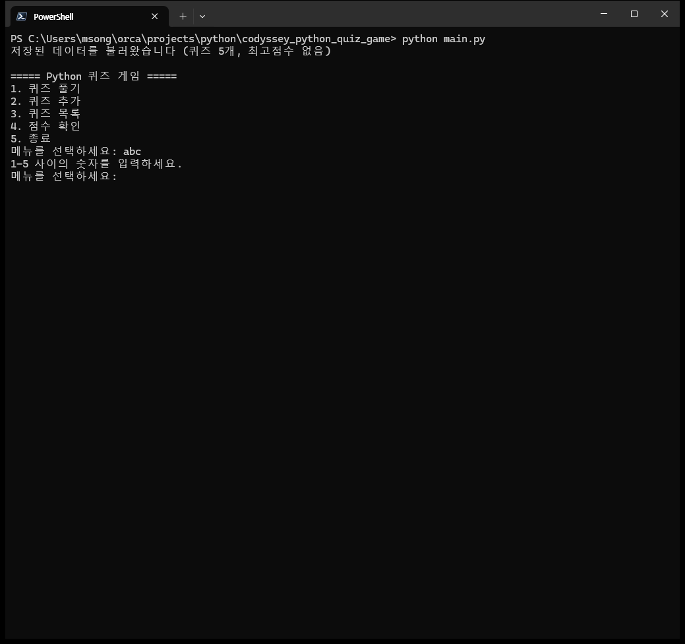
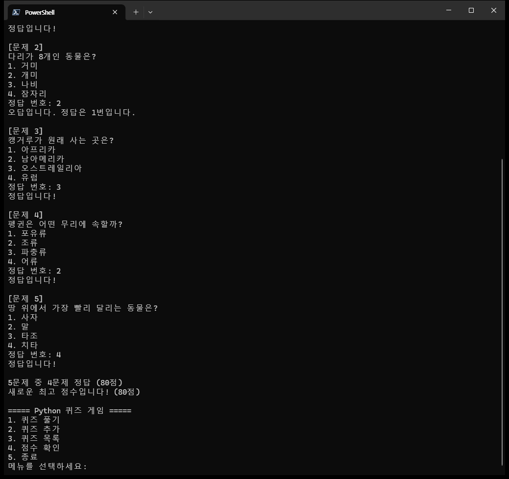
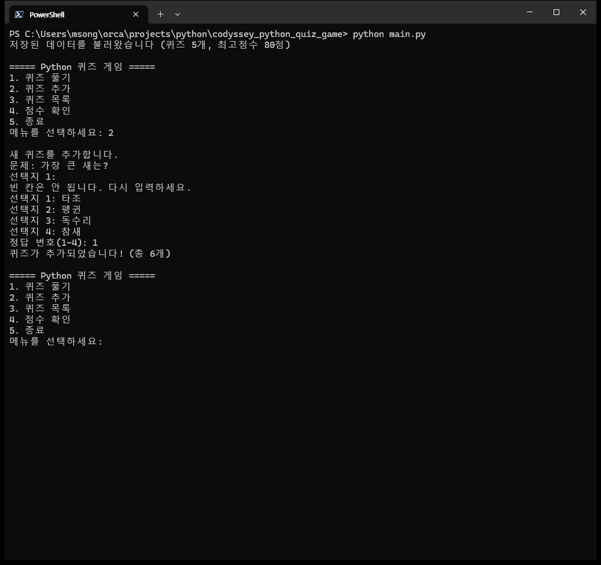
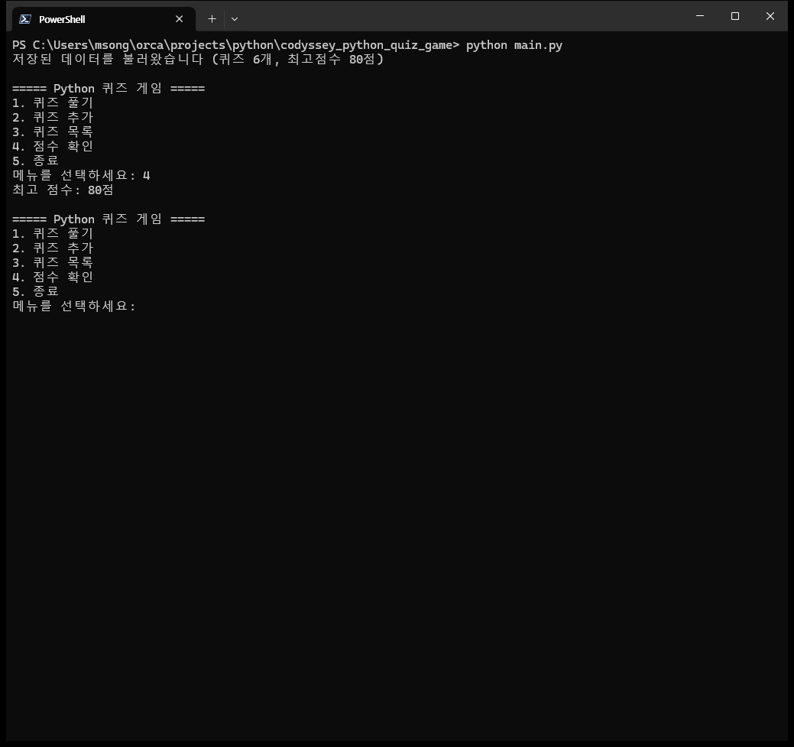
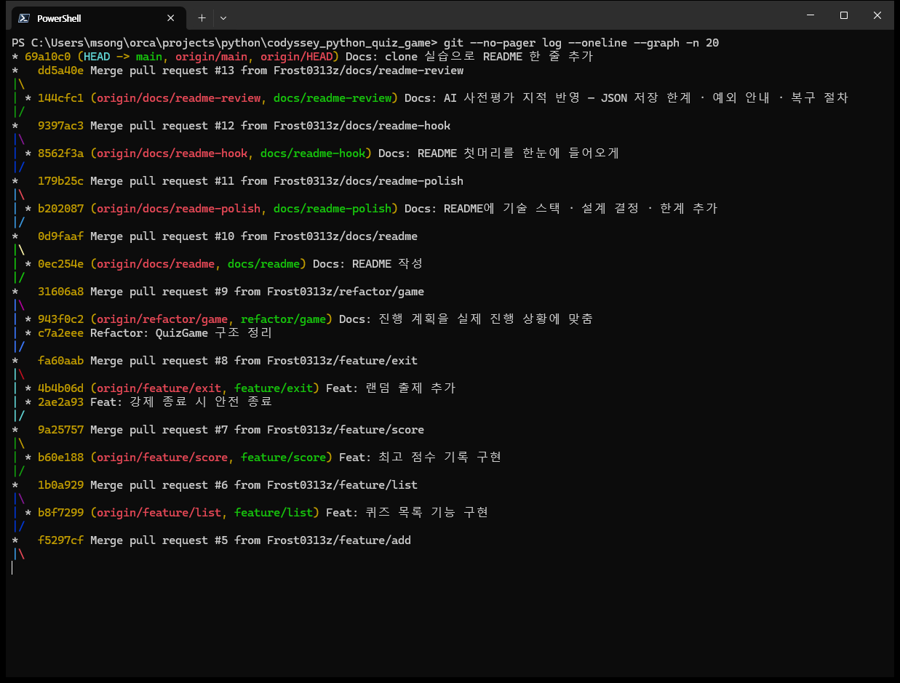
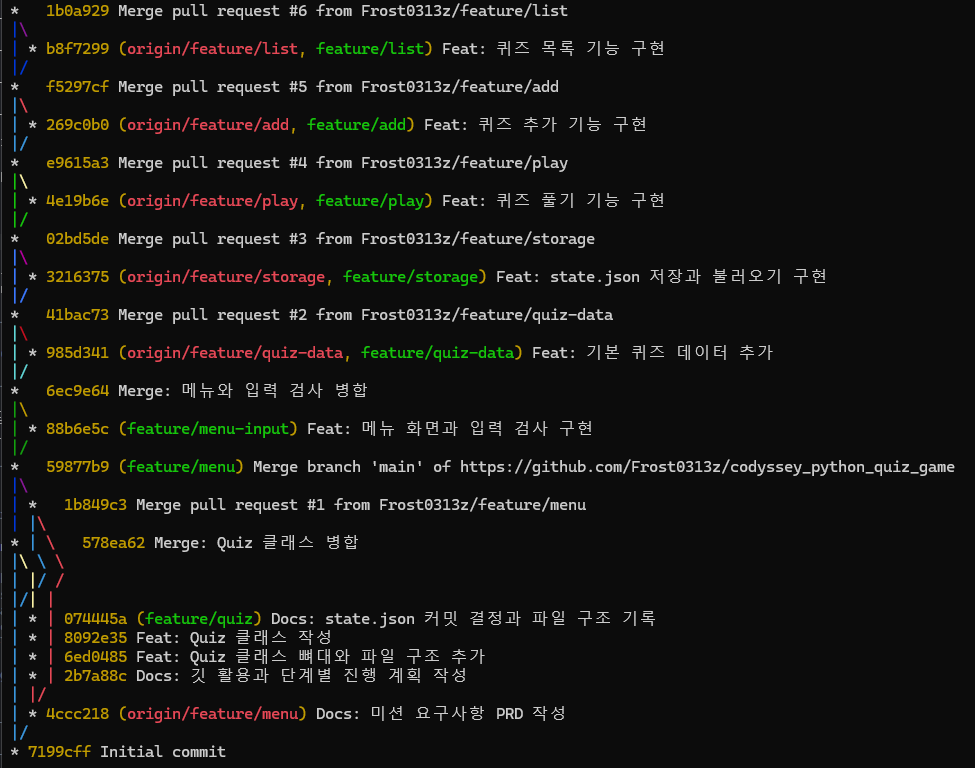
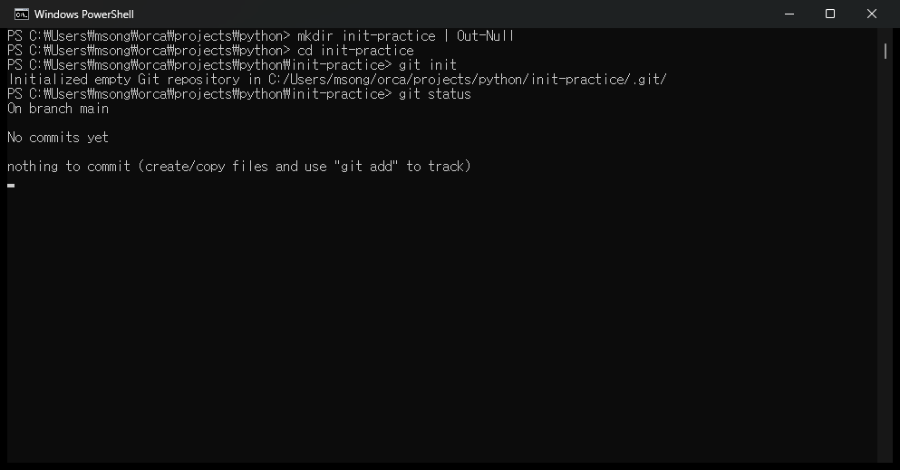
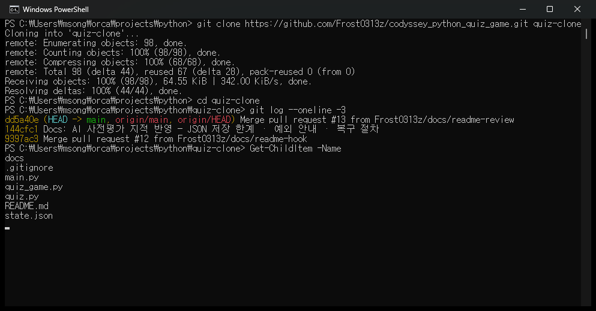
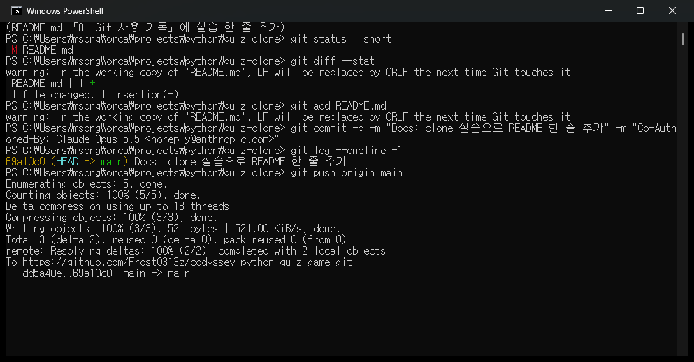
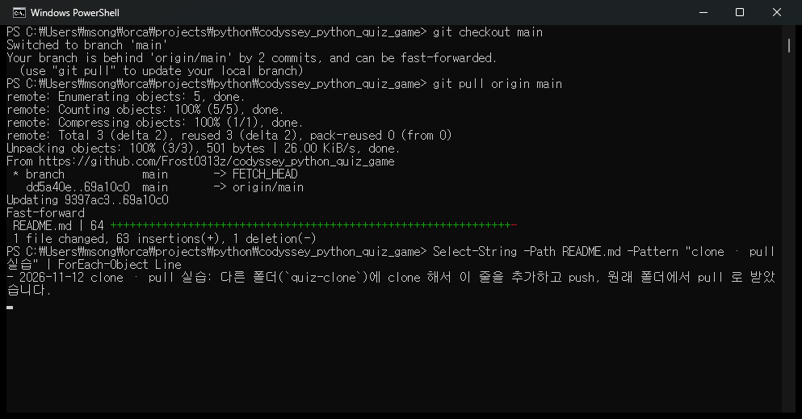

# 🐾 동물 퀴즈 게임

**흰긴수염고래부터 치타까지 — 터미널에서 동물 퀴즈를 풀고, 문제를 직접 만들고, 최고 점수에 도전하는 파이썬 게임**


```
[문제 2]
다리가 8개인 동물은?
1. 거미
2. 개미
3. 나비
4. 잠자리
정답 번호: 2
오답입니다. 정답은 1번입니다.
        ⋮
5문제 중 4문제 정답 (80점)
새로운 최고 점수입니다! (80점)
```

| | |
|---|---|
| 🎲 **랜덤 출제** | 풀 때마다 문제 순서가 섞입니다. 순서를 외워서는 못 풉니다 |
| ✍️ **퀴즈 만들기** | 문제 · 선택지 4개 · 정답만 넣으면 바로 저장. 내가 낸 문제로 친구에게 도전 |
| 🏆 **최고 점수** | 100점 만점으로 매겨 기록. 껐다 켜도 남습니다 |
| 🛡️ **안 꺼지는 입력** | 글자 · 빈 칸 · 범위 밖 숫자 · Ctrl+C 에도 오류 없이 다시 묻거나 조용히 종료 |

**30초 만에 해 보기**

```
git clone https://github.com/Frost0313z/codyssey_python_quiz_game.git
cd codyssey_python_quiz_game
python main.py
```

코디세이 미션 「Git과 함께하는 Python 첫 발자국」 결과물입니다. Python 기초 문법과 클래스로 게임을 만들고, Git 브랜치 · 커밋 · PR(Pull Request, 병합 요청)로 개발 기록을 남겼습니다.

---

## 1. 프로젝트 개요

- 터미널에서 메뉴를 골라 퀴즈를 풀고, 새 퀴즈를 추가하고, 최고 점수를 확인합니다.
- 퀴즈와 최고 점수는 `state.json` 파일에 저장되어, 프로그램을 껐다 켜도 남아 있습니다.
- 잘못된 입력(글자, 범위 밖 숫자, 빈 칸)이나 Ctrl+C에도 빨간 오류 문구(Traceback) 없이 동작합니다.

**기술 스택**

| 구분 | 사용한 것 |
|---|---|
| 언어 | Python 3 (3.10 이상) |
| 라이브러리 | 표준 라이브러리만 — `json`(저장 · 불러오기), `os`(파일 경로), `random`(문제 섞기) |
| 데이터 | JSON 파일 하나 (`state.json`) |
| 버전 관리 | Git · GitHub (기능별 브랜치 + PR) |

## 2. 퀴즈 주제와 선정 이유

- **주제:** 동물 퀴즈
- **선정 이유:** 동료평가에서 나이도 취향도 제각각인 사람들을 무작위로 만나게 됩니다. 누구와 이야기해도 통하는 주제가 동물이라고 생각했습니다.

## 3. 실행 방법

Python 3.10 이상이 필요합니다. (개발 환경: Python 3.14.6, Windows 11)

```
git clone https://github.com/Frost0313z/codyssey_python_quiz_game.git
cd codyssey_python_quiz_game
python main.py
```

다른 폴더에서 `python 경로/main.py` 로 실행해도 프로젝트 폴더의 `state.json` 을 그대로 씁니다.

## 4. 주요 기능 (기능 목록)

| 메뉴 | 기능 | 설명 |
|---|---|---|
| 1 | 퀴즈 풀기 | 저장된 퀴즈를 **순서를 섞어** 차례로 냅니다. 정답 · 오답을 바로 알려 주고, 끝나면 "5문제 중 4문제 정답 (80점)"처럼 결과를 보여 줍니다 |
| 2 | 퀴즈 추가 | 문제, 선택지 4개, 정답 번호(1~4)를 입력받아 추가하고 **바로 저장**합니다. 빈 칸은 다시 묻습니다 |
| 3 | 퀴즈 목록 | 등록된 퀴즈 수와 문제를 번호와 함께 보여 줍니다 (정답은 숨김) |
| 4 | 점수 확인 | 최고 점수를 보여 줍니다. 한 번도 안 풀었으면 "아직 기록 없음" |
| 5 | 종료 | 프로그램을 끝냅니다 |

**공통 처리**

- 숫자 입력은 앞뒤 공백을 지우고, 숫자가 아니거나 범위 밖이면 "1-5 사이의 숫자를 입력하세요." 처럼 범위를 알려 주고 다시 묻습니다.

  | 이렇게 입력하면 | 이렇게 안내하고 다시 묻습니다 |
  |---|---|
  | 메뉴에서 `abc` · 그냥 Enter · `9` · `0` · `-1` | `1-5 사이의 숫자를 입력하세요.` |
  | 정답에서 `5` · `abc` | `1-4 사이의 숫자를 입력하세요.` (같은 문제를 다시) |
  | 메뉴에서 ` 1 ` (앞뒤 공백) | 공백을 지우고 1번으로 처리 |
  | 퀴즈 추가에서 문제 · 선택지를 빈 칸으로 | `빈 칸은 안 됩니다. 다시 입력하세요.` |
  | Ctrl+C | `Ctrl+C 를 눌러 프로그램을 종료합니다. 저장된 퀴즈와 최고 점수는 그대로 남아 있습니다.` |
- 점수는 100점 만점입니다 (맞힌 수 ÷ 문제 수 × 100, 반올림). 퀴즈 수가 바뀌어도 공평하게 비교하기 위해서입니다.
- 다 풀었을 때 최고 점수보다 높으면 갱신하고 저장합니다. 풀던 도중 끊기면 그 판 점수는 버립니다.
- Ctrl+C 나 입력 끝(EOF, 더 들어올 입력이 없음)에서도 Traceback 없이 안내하고 종료합니다. 추가한 퀴즈와 최고 점수는 바뀌는 순간 이미 저장되어 있습니다.
- **보너스:** 풀 때마다 문제 순서가 랜덤으로 섞입니다.

### 실행 예시

```
저장된 데이터를 불러왔습니다 (퀴즈 5개, 최고점수 없음)

===== Python 퀴즈 게임 =====
1. 퀴즈 풀기
2. 퀴즈 추가
3. 퀴즈 목록
4. 점수 확인
5. 종료
메뉴를 선택하세요: 1

퀴즈를 시작합니다! (총 5문제, 순서는 매번 섞입니다)

[문제 1]
세상에서 가장 큰 동물은?
1. 아프리카코끼리
2. 흰긴수염고래
3. 기린
4. 백상아리
정답 번호: 2
정답입니다!
```

### 실행 화면

메뉴마다 실제로 실행한 터미널 화면입니다 (2026-11-12). 입력은 미리 정해 둔 값을 차례로 넣었습니다.

**메뉴** — 시작할 때 불러온 결과를 알리고, 잘못 입력(`abc`)하면 범위를 알려 주고 다시 묻습니다



**1. 퀴즈 풀기** — 순서를 섞어 출제하고, 틀리면 정답을 알려 줍니다. 끝나면 점수와 새 최고 점수



**2. 퀴즈 추가** — 빈 칸은 다시 묻고, 추가하면 바로 저장합니다



**4. 점수 확인** — 껐다 켜도 최고 점수(80점)와 추가한 퀴즈(6개)가 남아 있습니다



## 5. 파일 구조

```
codyssey_python_quiz_game/
├── main.py          # 실행 파일 — QuizGame 을 만들어 run() 만 부른다
├── quiz.py          # Quiz 클래스 — 문제 하나 (출력 · 정답 확인 · dict 로 바꾸기)
├── quiz_game.py     # QuizGame 클래스 — 메뉴 · 풀기 · 추가 · 목록 · 점수 · 저장 · 불러오기
├── state.json       # 퀴즈 목록과 최고 점수를 저장하는 데이터 파일
├── README.md
├── .gitignore
└── docs/
    ├── PRD.md                      # 미션 요구사항 정리 (요구 · 결정 · 시험)
    └── 깃-활용과-진행-계획.md      # 단계별 진행 계획과 Git 사용 기록
```

`Quiz` 는 `QuizGame` 을 모르고, `QuizGame` 만 `Quiz` 를 가져다 씁니다.

**한 번 실행하면 이렇게 흘러갑니다**

```
python main.py
  └ QuizGame() 생성 ─ load_data() ─ state.json 을 읽어 Quiz 객체 목록으로
      └ run() ─ Ctrl+C · 입력 끝을 여기서 한 번에 잡음
          └ menu_loop() ─ 메뉴 출력 → select_num_range(1~5)
               ├ 1 → play_quiz()       → 섞어서 출제 → check_answer() → update_high_score() → save_data()
               ├ 2 → input_new_quiz()  → Quiz 객체 생성 → add_quiz() → save_data()
               ├ 3 → show_list()
               ├ 4 → show_score()
               └ 5 → 종료
```

| 클래스 | 속성 | 메서드 |
|---|---|---|
| `Quiz` | `question` · `options` · `answer` | `show_quiz()` · `check_answer(user_answer)` · `to_dict()` |
| `QuizGame` | `quizzes` · `high_score` · `file_path` | `run()` · `menu_loop()` · `play_quiz()` · `input_new_quiz()` · `add_quiz(quiz)` · `show_list()` · `show_score()` · `update_high_score(score)` · `select_num_range(text, min_num, max_num)` · `input_text(text)` · `load_data()` · `save_data()` · `check_data(data)` · `check_quiz_item(item)` · `handle_broken_file(message)` |

## 6. 데이터 파일 — `state.json`

- **경로:** 프로젝트 폴더 (`main.py` 와 같은 곳). 실행한 폴더가 아니라 `quiz_game.py` 가 있는 폴더를 기준으로 찾습니다.
- **형식:** JSON(키와 값으로 데이터를 글자로 적는 형식), UTF-8 인코딩 — 한글을 글자 그대로 저장
- **역할:** 퀴즈 목록과 최고 점수를 프로그램을 끈 뒤에도 남깁니다. 기본 퀴즈 5개(동물)도 코드가 아니라 이 파일에 들어 있습니다.
- **저장 시점:** 퀴즈를 추가했을 때, 최고 점수가 바뀌었을 때 바로 저장합니다.

```json
{
    "quizzes": [
        {
            "question": "세상에서 가장 큰 동물은?",
            "options": ["아프리카코끼리", "흰긴수염고래", "기린", "백상아리"],
            "answer": 2
        }
    ],
    "high_score": null
}
```

| 키 | 형태 | 규칙 |
|---|---|---|
| `quizzes` | 목록 | 퀴즈들. 비어 있어도 된다 (퀴즈 0개) |
| `question` | 문자열 | 빈 글자가 아니다 |
| `options` | 문자열 4개 목록 | 정확히 4개 |
| `answer` | 정수 | 1~4 |
| `high_score` | 정수 또는 `null` | 0~100점. 한 번도 안 풀었으면 `null` |

**파일에 문제가 있을 때**

| 상황 | 동작 |
|---|---|
| 파일이 없음 | 안내 후 퀴즈 0개로 시작 (퀴즈를 추가하면 새로 만들어짐) |
| JSON 이 깨짐 · 규칙에 안 맞음 | 안내 → 기존 파일을 `state.json.bak` 으로 보관 → 퀴즈 0개로 시작 |

`state.json.bak` 은 `.gitignore` 로 저장소에 올리지 않습니다.

**`.bak` 에서 되살리는 법**

1. 프로그램을 끕니다.
2. `state.json.bak` 을 메모장으로 열어 깨진 곳(빠진 중괄호, 7 같은 정답 번호 등)을 고칩니다.
3. 이름을 되돌립니다. 지금 `state.json` 은 덮어써지니, 그사이 새로 추가한 퀴즈가 있으면 먼저 옮겨 적으세요.
   ```
   Move-Item -Force state.json.bak state.json
   ```
4. 다시 실행해 "저장된 데이터를 불러왔습니다 (퀴즈 N개, …)" 가 나오면 성공입니다.

**필드를 늘리고 싶다면** (예: 퀴즈마다 `category` · `hint`)

지금 코드는 퀴즈에 모르는 키가 있어도 막지 않고 불러옵니다. 하지만 저장할 때는 `question` · `options` · `answer` 세 키만 남깁니다. 키를 늘리려면 `Quiz.__init__` 의 속성과 `Quiz.to_dict()` 에 같이 더해야 합니다 (아래 「요구사항이 바뀌면 고칠 곳」).

## 7. 설계 결정

| 결정 | 이유 |
|---|---|
| 파일을 `main.py` · `quiz.py` · `quiz_game.py` 셋으로 나눔 | 수업 예시는 한 파일이지만, 문제 하나(`Quiz`)와 게임 전체(`QuizGame`)의 책임을 파일로도 나눠 읽기 쉽게 |
| 기본 퀴즈를 코드에 두지 않고 `state.json` 에만 | 퀴즈 데이터는 한 곳에서만 관리. 저장소에 올라간 `state.json` 이 곧 초기 퀴즈 5개 |
| 점수를 맞힌 개수가 아니라 100점 만점으로 | 퀴즈를 추가하면 문제 수가 바뀌어 개수로는 공평하게 비교할 수 없어서 |
| 안 푼 상태를 `0` 이 아니라 `null` 로 | "0점"과 "아직 안 풂"을 구분하려고 |
| 추가 · 최고 점수 갱신 때 **바로** 저장 | 갑자기 꺼져도 남도록. 그래서 종료할 때 따로 저장할 것이 없다 |
| 깨진 파일은 지우지 않고 `.bak` 로 보관 | 안에 든 퀴즈를 손으로 고쳐 살릴 수 있게 |
| 문제를 섞을 때 목록의 **복사본**만 섞음 | 원본을 섞으면 저장할 때 `state.json` 순서까지 바뀌어서 |
| 숫자 입력을 `select_num_range` 하나로 | 메뉴(1~5) · 정답(1~4) · 정답 번호 등록(1~4) 세 곳이 범위만 다르고 검사는 같아서 |
| 함수만 쓰지 않고 클래스(`Quiz` · `QuizGame`)로 | 함수만 쓰면 퀴즈 목록 · 최고 점수 · 파일 경로를 함수마다 넘기거나 전역 변수로 둬야 합니다. 클래스는 데이터와 그 데이터를 다루는 메서드를 한 묶음(`self`)으로 들고 다녀 실수가 줄어듭니다. 대신 이 정도 크기에서는 코드 줄 수가 조금 늘어납니다 |
| 저장소로 SQLite 같은 DB(데이터베이스) 대신 JSON 파일 하나 | 퀴즈가 수십 개 수준이라 사람이 메모장으로 열어 읽고 고칠 수 있는 쪽이 낫고, 표준 라이브러리 `json` 만으로 됩니다. 커지면 한계가 있습니다 (9장 「JSON 저장 방식의 한계」) |

### 요구사항이 바뀌면 고칠 곳

| 바뀌는 것 | 먼저 고칠 곳 | 그다음 |
|---|---|---|
| 퀴즈 하나의 모양 (필드 추가 · 선택지 개수) | `quiz.py` — `Quiz.__init__` · `to_dict()` · `show_quiz()` | `quiz_game.py` — `check_quiz_item()` · `input_new_quiz()` · `load_data()` 의 `Quiz(...)` 생성 줄 |
| 저장 방식 (파일 위치 · 형식 · DB) | `quiz_game.py` — `load_data()` · `save_data()` | `check_data()` · `handle_broken_file()` |
| 메뉴 추가 · 순서 | `quiz_game.py` — `menu_loop()` | 숫자 범위 `select_num_range("메뉴를 선택하세요: ", 1, 5)` 의 5 |
| 점수 계산 · 최고 점수 기준 | `quiz_game.py` — `play_quiz()` 의 `score` 줄 | `update_high_score()` · `check_data()` 의 0~100 검사 |
| 입력 검사 규칙 | `quiz_game.py` — `select_num_range()` · `input_text()` | — |

## 8. Git 사용 기록

- 기능마다 브랜치를 따서 작업하고(`feature/play`, `feature/add` 등), GitHub PR로 `main` 에 병합했습니다.
- 커밋은 기능 단위로 `Feat:` · `Docs:` · `Refactor:` 머리말을 붙였습니다 — 병합 제외 24개 (2026-11-12 기준).
- 진행 단계와 커밋 · PR 기록은 [docs/깃-활용과-진행-계획.md](docs/깃-활용과-진행-계획.md), 요구사항과 결정은 [docs/PRD.md](docs/PRD.md) 에 있습니다.
- 2026-11-12 clone · pull 실습: 다른 폴더(`quiz-clone`)에 clone 해서 이 줄을 추가하고 push, 원래 폴더에서 pull 로 받았습니다.

### 커밋 그래프 (`git log --oneline --graph`)

기능마다 브랜치가 갈라졌다가 PR 로 `main` 에 합쳐진 모양입니다. 길어서 두 장으로 나눴습니다.

**최신 쪽** — clone 실습 커밋부터 PR #5 까지



**처음 쪽** — PR #6 부터 `Initial commit` 까지



### init · clone · push · pull 실습

다른 컴퓨터의 팀원을 흉내 내려고, 저장소를 다른 폴더(`quiz-clone`)에 받아 고쳐 올리고 원래 폴더에서 받아 왔습니다 (2026-11-12).

**① `git init`** — 빈 폴더(`init-practice`)를 Git 저장소로 만들기



**② `git clone`** — GitHub 저장소를 다른 폴더에 통째로 받기



**③ `git add` · `commit` · `push`** — 받은 폴더에서 README 에 위 실습 줄을 더해 올리기



**④ `git pull`** — 원래 폴더에서 받아 와 추가한 줄이 보이는지 확인



## 9. 한계

- 퀴즈를 **고치거나 지우는** 메뉴는 없습니다. 바꾸려면 `state.json` 을 직접 고칩니다.
- 선택지는 늘 4개입니다.
- `state.json` 을 손으로 고칠 때 선택지를 빈 글자(`""`)로 넣으면 그대로 불러옵니다 (추가 메뉴에서는 막습니다).

### JSON 저장 방식의 한계

이 게임은 **파일 전체를 한 번에 읽고, 바뀔 때마다 파일 전체를 다시 씁니다.** 퀴즈 1개만 추가해도 나머지 전부를 다시 씁니다. 퀴즈 수를 늘려 가며 실제로 재 봤습니다.

| 퀴즈 수 | 파일 크기 | 불러오기 | 퀴즈 1개 추가 후 저장 | 불러올 때 메모리 최고 |
|---|---|---|---|---|
| 5개 (지금) | 1 KB 미만 | 17 ms | 1 ms | 0.1 MB |
| 1,000개 | 0.28 MB | 30 ms | 14 ms | 1.3 MB |
| 100,000개 | 28.5 MB | 963 ms | 1,471 ms | 120.5 MB |

측정: 2026-11-12, Windows 11 · Intel 노트북 · Python 3.14.6, 이 저장소의 `QuizGame` 그대로 (메모리는 `tracemalloc` 으로 재서 시간이 조금 더 걸렸을 수 있음).

- **성능:** 퀴즈가 많아지면 추가 한 번에도 저장이 눈에 띄게 느려집니다 (10만 개에서 1.5초).
- **메모리:** 퀴즈 전부를 Quiz 객체로 메모리에 올립니다. 10만 개면 불러오는 동안 120 MB 가까이 씁니다.
- **동시 사용:** 두 사람이 같은 파일로 동시에 실행하면 나중에 저장한 쪽이 앞의 내용을 덮어씁니다.
- **저장 중 꺼짐:** 파일을 쓰는 도중 컴퓨터가 꺼지면 반쯤 쓴 파일이 남을 수 있습니다. 다음 실행 때 `.bak` 으로 보관되긴 하지만 그 사이 추가분은 잃습니다.

**커지면 이렇게 바꿉니다**

| 대안 | 좋아지는 점 | 대가 |
|---|---|---|
| SQLite (표준 라이브러리 `sqlite3`) | 퀴즈 1개만 추가 · 수정, 필요한 만큼만 읽기, 저장 중 꺼져도 안전 | 메모장으로 바로 읽고 고칠 수 없음, SQL(데이터베이스에 묻는 언어)을 배워야 함 |
| 임시 파일에 쓴 뒤 이름 바꾸기 (`os.replace`) | 저장 중 꺼져도 반쯤 쓴 파일이 안 남음 | 속도 · 메모리 문제는 그대로 |
| 퀴즈를 여러 파일로 나누기 (주제별 등) | 한 번에 읽고 쓰는 양이 줄어듦 | 파일 관리가 복잡해짐 |

지금 규모(수십 개)에서는 JSON 한 파일이 가장 단순하고, 사람이 읽고 고치기 쉬워서 그대로 둡니다.
